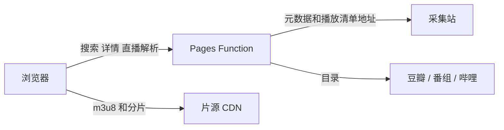

# CKTV


影视聚合播放器。目录、搜索和直播解析走 Cloudflare Pages，正片分片由浏览器直接向片源 CDN 请求。普通片、直播、18+、AI 黄果分栏，成人源不进入全站搜索。

[](https://nextjs.org/)
[](https://developers.cloudflare.com/pages/)
[](https://pages.cloudflare.com/)
[](https://github.com/video-dev/hls.js/)

在线：[tv.chuankangkk.top](https://tv.chuankangkk.top) · 预览：[ck-tv.pages.dev](https://ck-tv.pages.dev) · 仓库：[1837620622/ck_tv](https://github.com/1837620622/ck_tv)

## 赞助

CKTV 由个人维护。域名、Pages 和接口巡检没有团队。用得顺手，希望能赞助这个项目，金额随意。不赞助也可以正常观看。

<table>
  <tr>
    <td width="70%">
      <p>赞助用来续域名，以及继续改播放、缓存和直播线路。</p>
      <ul>
        <li>微信：1837620622（传康Kk）</li>
        <li>邮箱：2040168455@qq.com</li>
        <li>咸鱼 / B站：万能程序员</li>
      </ul>
    </td>
    <td>
      
    </td>
  </tr>
</table>

## 技术栈

| 层       | 选择                                                                                                                         |
| -------- | ---------------------------------------------------------------------------------------------------------------------------- |
| 界面     | Next.js 14 App Router，React 18，Tailwind CSS                                                                                |
| 接口     | `src/app/api/*`，`export const runtime = 'edge'`                                                                             |
| 托管     | Cloudflare Pages，`@cloudflare/next-on-pages`                                                                                |
| 点播     | ArtPlayer，HLS 由 hls.js 或浏览器原生播放                                                                                    |
| 直播     | hls.js，固定清单优先，失败再向央视网页接口要新地址                                                                           |
| 片源     | `config.json` 里的 Apple CMS，`api.php/provide/vod`                                                                          |
| 个人数据 | 默认 `localStorage`：收藏、进度、跳过设置、代理开关。`NEXT_PUBLIC_STORAGE_TYPE` 设为 `d1`、`redis` 或 `upstash` 后存到服务端 |
| 包管理   | pnpm                                                                                                                         |

## 请求怎么走



Pages 只经手清单、海报和目录 JSON。`.ts` 分片不进本站，也不在边缘转发。

1. 首页目录来自豆瓣、番组计划或哔哩排行。哔哩排行返回 412 时，目录改用豆瓣条目。点开卡片后按片名到普通片源里检索，不使用哔哩播放地址。
2. 全站搜索只请求 `api_site`。每个源只取第一页，避免翻页把无关条目带进来。
3. 详情返回分集 m3u8。浏览器拉清单，再按清单向片源 CDN 要分片。Safari 可走原生 HLS，其他浏览器走 hls.js。
4. 换源测速只读播放清单：从 `RESOLUTION` 取清晰度，记录一次往返。失败就是失败，不编造速度。源的先后按 `config.json` 的优先级，不按测速毫秒重排。已经出画的线路不自动换掉。
5. 直播先播写死的 HTTPS 清单。这条失败，再请求 `/api/live?id=&fresh=1` 向央视网页接口要新地址。出画才算成功，只解析到清单不算。播放地址 `Cache-Control: no-store`。
6. CCTV-1、CCTV-13 使用实际为 720 的 `td` 媒体清单。主清单把 `pd` 标成 1080，分片实测是 360，所以不走那一档，也不按主清单的码率标签去锁最高档。

## 接入片源

片源写在 `config.json` 的 `api_site`，格式是苹果 CMS 的 `api.php/provide/vod`：

```json
"xxzy": { "name": "某某资源", "api": "https://example.com/api.php/provide/vod" }
```

新源先加上 `"disabled": true`，搜索和详情都不会请求它。在能访问上游的机器上验证：

```bash
node scripts/test-apis.js --keyword=凡人
```

脚本用和搜索一样的请求方式，检查返回的条目里有没有 m3u8 播放地址，并抽一条清单确认是 `#EXTM3U`。通过的源会输出一段可以直接粘贴的配置，去掉 `disabled` 即可启用。

## 缓存

Pages Function 的响应默认是动态的，`Cache-Control` 不会自动进边缘。聚合 JSON 由代码写入 Cache API，并用 `cf.cacheTtl` 控制回源。

| 数据                         | 处理                           |
| ---------------------------- | ------------------------------ |
| 有内容的目录、搜索、成人列表 | 写入边缘缓存                   |
| 空列表                       | `no-store`，不写入             |
| 直播解析                     | `no-store`，`cf.cacheTtl = 0`  |
| 黄果封面解密结果             | 解密成功后缓存，只接受指定图床 |
| 视频分片                     | 不缓存，不代理                 |

不设置自定义 `cacheKey`。

## 栏目隔离

| 栏目               | 路径                  | 数据                                                                                        |
| ------------------ | --------------------- | ------------------------------------------------------------------------------------------- |
| 首页 / 搜索 / 点播 | `/` `/search` `/play` | 只使用 `api_site`                                                                           |
| 豆瓣 / 番组 / 哔哩 | `/douban`             | 目录在上游，播放仍回普通片源                                                                |
| 直播               | `/live`               | 公开 HTTPS 清单，或现取的央视地址。抖音、快手、哔哩直播、斗鱼、虎牙、央视频、闲鱼只打开官网 |
| 18+                | `/adult`              | 只使用 `adult_api_site`，不参与全站搜索                                                     |
| AI 黄果            | `/huangguo`           | 独立接口。封面经 `/api/huangguo/cover` 解密后显示，密钥不返回浏览器                         |

18+ 和 AI 黄果只在国外网络显示入口。中国大陆、香港、澳门、台湾不出现这两个栏目，首页、搜索、点播、直播等其它栏目照常打开。国家只认 Cloudflare 平台给出的来源（Pages 的平台信息，或 Worker 的 `request.cf`），访客自己带的 `CF-IPCountry` 不算。本地和 Docker 部署拿不到这些信息，两个栏目默认关闭。国外网络还要口令正确，口令和签名密钥见下面的「栏目口令」。地区不符或口令不对时，列表、封面、播放地址，以及播放记录和收藏里的成人内容都不会返回。

## 目录

```text
src/app            页面和 Edge 接口
src/components     界面
src/lib            片源、搜索、缓存、直播、黄果
config.json        普通源和成人源
scripts            生成 runtime、manifest、版本号
public             图标和赞赏码
```

`pnpm gen:runtime` 把 `config.json` 写成 `src/lib/runtime.ts`。这个文件不提交。提交前的钩子会重写版本号，不要手改 `src/lib/version.ts` 和 `VERSION.txt`。

## 本地

```bash
pnpm install
pnpm dev
```

开发地址是 `http://127.0.0.1:3000`。`pnpm dev` 会先生成 runtime 和 manifest，再启动 Next.js。

```bash
pnpm lint:strict
pnpm typecheck
pnpm test
```

本地环境变量写在 `.env.local`，这个文件已经被 `.gitignore` 忽略。本地拿不到 Cloudflare 的国家信息，18+ 和 AI 黄果保持关闭，见「栏目口令」。

## 部署

没有管理后台，配置靠环境变量、`config.json` 和 `src/lib/gate-config.ts`。

### Cloudflare Pages

项目名 `ck-tv`，生产域名 `tv.chuankangkk.top`，同时保留 `ck-tv.pages.dev`。

| 项目         | 设置                                                                    |
| ------------ | ----------------------------------------------------------------------- |
| 构建命令     | `pnpm install --frozen-lockfile && pnpm run pages:build`                |
| 构建输出目录 | `.vercel/output/static`                                                 |
| 构建变量     | `NODE_VERSION` = `20`，和仓库里的 `.nvmrc` 一致                         |
| 兼容性标志   | 生产和预览都开启 `nodejs_compat`，必需                                  |
| D1 绑定      | 用 D1 存数据时添加，变量名 `DB`。建表语句见 [D1 初始化.md](D1初始化.md) |

`pages:build` 依次执行 `gen:runtime`、`gen:manifest`、`next build` 和 `@cloudflare/next-on-pages`。输出目录名里的 `vercel` 是 next-on-pages 的中间格式。`vercel` 包只在本地构建时被调用，用来生成这个目录，部署不经过 Vercel。

改了 `NEXT_PUBLIC_` 开头的变量，或者改了 Pages 环境变量，都要重新部署才生效。`NEXT_PUBLIC_` 的值在构建时写进前端代码。

### 环境变量

| 变量                                            | 作用                                                    | 什么时候配                     |
| ----------------------------------------------- | ------------------------------------------------------- | ------------------------------ |
| `GATE_TRUST_COUNTRY_HEADER`                     | 设为 `true` 后读取 `CF-IPCountry`                       | 只限前面挂着 Cloudflare 的部署 |
| `CRON_SECRET`                                   | `/api/cron` 的 Bearer 口令，没配时该接口一律 401        | 要定时刷新播放记录和收藏时     |
| `NEXT_PUBLIC_STORAGE_TYPE`                      | `localstorage`（默认）、`d1`、`redis`、`upstash`        | 要把收藏和播放记录存到服务端时 |
| `REDIS_URL`                                     | Redis 连接地址                                          | `redis` 模式                   |
| `UPSTASH_URL`、`UPSTASH_TOKEN`                  | Upstash 的 REST 地址和令牌                              | `upstash` 模式                 |
| `CLOUDFLARE_ACCOUNT_ID`、`CLOUDFLARE_API_TOKEN` | 调用 Workers AI 生成字幕                                | 要用 AI 字幕时                 |
| `SITE_NAME`                                     | 站点名称，默认 `CKTV-传康播放器`                        | 想改名字时                     |
| `ANNOUNCEMENT`                                  | 公告文字                                                | 想发公告时                     |
| `NEXT_PUBLIC_IMAGE_PROXY`                       | 图片代理地址。豆瓣图片不配也会走本站 `/api/image-proxy` | 可选                           |
| `NEXT_PUBLIC_DOUBAN_PROXY`                      | 豆瓣数据请求的代理地址                                  | 可选                           |

`d1` 模式需要 D1 绑定 `DB`，`redis` 和 `upstash` 模式需要对应的地址和令牌。

### 定时刷新

Pages 没有内置定时任务。用外部定时器（cron-job.org、GitHub Actions 等）每天请求一次：

```bash
curl -H "Authorization: Bearer $CRON_SECRET" https://tv.chuankangkk.top/api/cron
```

接口会回源重新取详情，集数变了就更新播放记录和收藏。`NEXT_PUBLIC_STORAGE_TYPE` 是 `localstorage` 时直接跳过。

Docker 部署由 `start.js` 自动调用，不需要外部定时器。

### Docker

```bash
docker build -t cktv .
docker run -d -p 3000:3000 cktv
```

镜像用 Node 20 运行。`PORT` 默认 3000，`HOSTNAME` 默认 `0.0.0.0`。`CRON_SECRET` 没设时，`start.js` 生成一个只在本进程里有效的值，每小时调用一次 `/api/cron`，不用配。

容器里拿不到 Cloudflare 的国家信息，18+ 和 AI 黄果默认关闭。确认前面挂着 Cloudflare 并且它会覆盖 `CF-IPCountry` 后，再加 `-e GATE_TRUST_COUNTRY_HEADER=true`。

Docker 默认是 `localstorage`。`NEXT_PUBLIC_` 开头的变量在 `docker build` 时就写进前端了，`docker run -e` 改不了它们。要换存储类型，得先在 Dockerfile 的构建阶段加上对应的 `ENV`，再重新构建。`d1` 只在 Cloudflare 上可用。

### 栏目口令

18+ 和 AI 黄果只对国外网络开放，进入还要口令。口令和签名密钥写在 `src/lib/gate-config.ts`，部署时不需要配置任何环境变量。

**仓库是公开的，所以口令等于公开。** 这是为了部署不用配变量做的取舍。门控仍然会检查国家，中国大陆、香港、澳门、台湾不能进入，但读代码的人能直接看到口令。

| 位置                                     | 说明                                                                                                                            |
| ---------------------------------------- | ------------------------------------------------------------------------------------------------------------------------------- |
| `gate-config.ts` 里的 `GATE_PASSWORD`    | 口令。不区分大小写，首尾空格忽略。                                                                                              |
| `gate-config.ts` 里的 `GATE_SIGNING_KEY` | 签 cookie 的密钥，至少 32 个字符，不要和口令相同。                                                                              |
| `GATE_TRUST_COUNTRY_HEADER`（环境变量）  | 默认不读 `CF-IPCountry`，因为访客自己也能带这个头。确认前面挂着 Cloudflare、且它会覆盖这个头时才设为 `true`。Pages 部署不用设。 |

- 换口令：改 `GATE_PASSWORD`，提交并重新部署。已经通过的 cookie 在 7 天内仍然有效。
- 换签名密钥：改 `GATE_SIGNING_KEY`，提交并重新部署。所有人都要重新输入口令。
- cookie 有效 7 天，服务端每次请求都校验签名。
- 同一个 IP 在 15 分钟内口令错 5 次，之后在这个窗口结束前不再接受尝试。计数只在单个实例里有效，正式环境还要在 Cloudflare 的限流规则里给 `POST /api/gate` 加一条。

## 边界

- 不代理 HLS 分片，不在服务端预下载正片来测速。
- 不把 `adult_api_site` 并进全站搜索。
- 不缓存空列表和直播播放地址。
- 不按测速结果打乱 `config.json` 里的源顺序。
- 直播不写入会过期的签名地址，也不接入需要逆向客户端的房间流。
- 去广告只处理清单里标出来的插播（CUE 标记，或不连续标记框住的 15 秒内短段）。画面里直接压着的广告、没有任何标记的插播，清单层看不到，过滤不了。
- 直播健康检查在部署环境里跑，结果只决定排序和变暗，不隐藏频道。

## 免责声明

普通栏目的片源来自公开接口，仅供学习与技术交流。本站不存储、不制作视频。

18+ 和 AI 黄果只给年满 18 周岁的访客。本站不制作、不存储、不传播这些影片，只是把第三方公开接口接到播放器里，优化站点的浏览和播放。视频在对方服务器，本站不留副本。

未满 18 周岁不要进入。进入之后的观看由访客自己负责。

进入这两个栏目前会看到同样的声明。中国大陆、香港、澳门、台湾不能进入。
